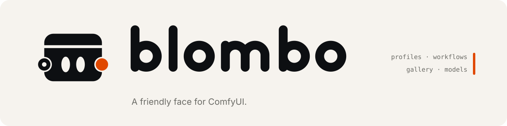

<p align="center">
  <picture>
    <source media="(prefers-color-scheme: dark)" srcset="assets/brand/banner-dark.svg" />
    
  </picture>
</p>

<p align="center">
  <a href="#run"><b>Run</b></a> ·
  <a href="#comfyui">ComfyUI</a> ·
  <a href="docs/status.md">Status</a> ·
  <a href="AGENTS.md">Agents</a> ·
  <a href="docs/architecture.md">Architecture</a> ·
  <a href="docs/adr">Decisions</a>
</p>

A studio for ComfyUI on your PC. Make a profile, drop in any ComfyUI workflow, and generate from a screen you
arrange yourself, with your images, models and wildcards beside it. ComfyUI still does the work: graphs stay real
ComfyUI graphs, and **Edit in ComfyUI** opens one there and brings your changes back.

- **Profiles.** Each has its own folders, workflows, layouts, settings, picture and accent color. Switch without
  restarting.
- **Any workflow.** Drag in a workflow JSON or a ComfyUI image, and BlomboUI finds the prompts, models, sampler, size
  and LoRAs. Add Hires fix, ADetailer and ControlNet as stages; the custom nodes they need install in one click.
- **A Generate screen you arrange.** Move any block, switch a control between slider, scrub bar, chips or dropdown,
  and keep the layout with the workflow. The prompt editor completes tags, LoRAs, trigger words and wildcards.
- **Your library.** A gallery with search, favorites, ratings, tags, collections and a trash you can restore from.
  Local models, a Civitai browser with a download queue, and the ComfyUI Manager catalog.
- **Nothing to install.** It runs from this folder, and everything it saves stays in `data/` and `runtime/`.

## Run

Windows 10/11 and [Node.js](https://nodejs.org) 22.18+.

- `start-web.bat` builds the app if needed and opens http://127.0.0.1:4380.
- `start-app.bat` opens it in its own window. The first run builds the window, which needs [Rust](https://rustup.rs).
- `start-dev.bat` runs hot-reload dev mode on http://127.0.0.1:4382.

The first launch shows the profile screen: name a profile, point it at your models, outputs and wildcards folders,
choose a ComfyUI and pick starter workflows.

## ComfyUI

A profile uses a ComfyUI that BlomboUI installs and runs for you (Settings → ComfyUI → Install, into
`runtime/comfyui/`), or the address of one you already run. Generating needs an NVIDIA GPU; without one, the fake
ComfyUI in [AGENTS.md](AGENTS.md) → Commands lets you click through everything. What was checked on a real ComfyUI:
[docs/status.md](docs/status.md).

## Develop

```bash
npm install
npm run dev
npm run check
```

`npm run check` runs types, lint, tests and the rules sync. The Design Lab at `/lab` shows every token, icon and
control in every theme. Agents start at [AGENTS.md](AGENTS.md); the map is
[docs/architecture.md](docs/architecture.md), the look is [docs/design-system.md](docs/design-system.md).

## License

MIT. See [LICENSE](LICENSE).
