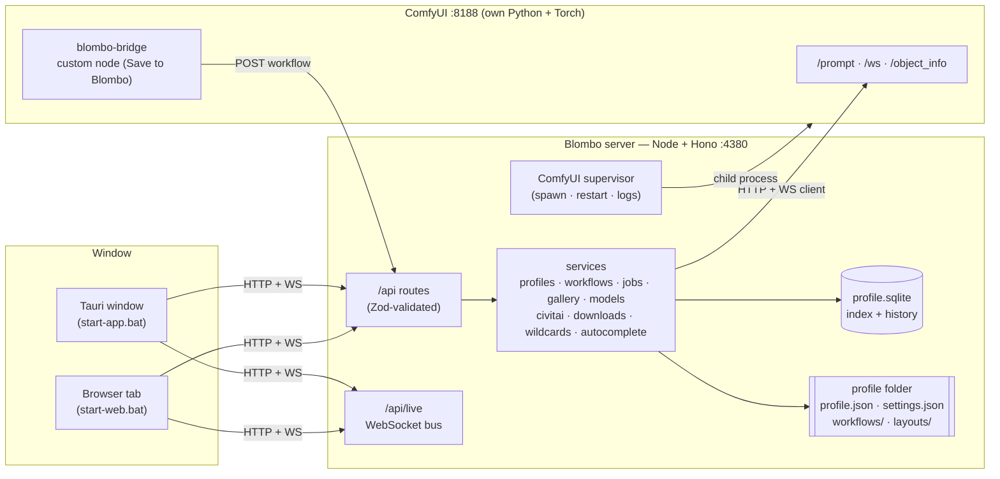

# BlomboUI — Architecture

BlomboUI is a local, profile-based studio for ComfyUI. ComfyUI does the work of generating images. BlomboUI makes that work pleasant: profiles, workflows you can import and edit, a Generate screen you can customize, a gallery, model management (local, Civitai, ComfyUI Manager), wildcards, and helpers that ComfyUI does not have.

This document is the map. Decisions and their reasons are in [`adr/`](adr/). The look and feel is in [`design-system.md`](design-system.md). The workflow format is in [`workflows.md`](workflows.md).

## Principles

1. **ComfyUI is the engine, Blombo is the cockpit.** Generation graphs stay real ComfyUI graphs. Blombo never builds a parallel engine. It binds UI to graph inputs, patches graphs with stages, and submits them.
2. **One language, one schema.** TypeScript end to end. Every shape that crosses the wire, or lands on disk, is a Zod schema in `src/shared/`. Nothing is validated twice in two languages.
3. **Workflows are data, not code.** Adding a workflow means dropping a file, not editing Python or TSX. Built-in presets use the same format as user imports.
4. **The UI is data too.** The Generate screen is a layout document. The default layout is one preset among others. Users can move blocks and change control styles, and nothing is hardcoded to one workflow.
5. **Push, don't poll.** One WebSocket carries job progress, previews, GPU stats, downloads, gallery inserts and errors.
6. **Fast by default.** Virtualized grids, cached thumbnails with immutable URLs, lazy views, sliced stores, and no layout thrash in the prompt editor.
7. **Files you can read.** Profiles, settings, workflows and layouts are JSON files in a profile folder. SQLite holds only indexes and logs, which can be rebuilt.

## System overview



- **Server** (`src/server`): Node 22+ running TypeScript directly (type stripping), Hono for HTTP, `ws` for WebSocket, `node:sqlite` for storage, `sharp` for thumbnails and grids. It serves the built client in production.
- **Client** (`src/client`): React 19, Vite, Tailwind 4, TanStack Router and Query, Zustand for UI state, Motion for animation, Floating UI for anything that floats, dnd-kit for layout editing, CodeMirror 6 for YAML and prompts, TanStack Virtual for big grids.
- **Shared** (`src/shared`): vocabulary (roles, model kinds, samplers), Zod schemas (settings, profile, workflow manifest, layout document, API bodies), and pure logic used on both sides (prompt syntax parser, wildcard grammar, resolution math).
- **Desktop** (`src-tauri`): a thin native window that opens the local server URL. The page and the web build are the same. Small platform hooks (open a second window for ComfyUI, native notifications) go through `client/lib/platform.ts`.
- **ComfyUI**: installed per *slot* under `runtime/comfyui/<slot>/` with its own Python (a private venv the in-app installer sets up with uv, or a portable build placed there by hand). Blombo supervises the process, writes `extra_model_paths.yaml` from the active profile, and (later) installs the **blombo-bridge** extension into `custom_nodes/`.

## Source layout

```text
BlomboUI-new/
├── start-web.bat / start-app.bat / start-dev.bat   launchers (Windows first; .sh later)
├── src/
│   ├── shared/        constants · schemas · api types · prompt/ · workflow/ · layout/
│   ├── server/
│   │   ├── main.ts        flags (--dev --port --open web|app|none), wiring, single instance
│   │   ├── app.ts         routes + static client
│   │   ├── routes/        one file per area, thin: validate → service → respond
│   │   ├── services/      profiles · settings · comfy/ · workflows/ · jobs/ · gallery/ · models/
│   │   │                  civitai/ · downloads/ · wildcards/ · autocomplete/ · live (event bus)
│   │   ├── db/            sqlite open/migrate + repositories
│   │   └── lib/           fsx (safe paths, atomic writes), http (errors), images (sharp)
│   ├── client/
│   │   ├── app/           shell, router, header, avatar menu, view transitions
│   │   ├── features/      profiles · generate · gallery · models · wildcards · fileinfo
│   │   │                  settings · history · errors · help · scopes · workflows · lab
│   │   ├── ui/            design-system controls (hand-built, token-driven)
│   │   ├── icons/         custom SVG icon set
│   │   ├── lib/           api · live (ws) · queries · motion · hotkeys · platform · format
│   │   └── styles/        tokens.css · base.css
│   └── comfy-bridge/      ComfyUI extension (JS) shipped into each managed ComfyUI
├── presets/
│   ├── workflows/     built-in workflow packages: sd15, sdxl, illustrious (planned: noobai, anima,
│   │                  krea2, background-removal, upscale, caption, dataset)
│   ├── stages/        graph patches: hires, adetailer, controlnet, upscale
│   └── layouts/       built-in Generate layouts
├── installer/         ComfyUI slots, Torch builds, attention kernels
├── src-tauri/         desktop shell
├── tools/             ensure-build · ensure-app · sync-rules · dev-window · make-icons · build-presets
├── docs/              architecture · design-system · workflows · adr/
├── data/              (gitignored) profiles.json + profiles/<id>/
└── runtime/           (gitignored) comfyui/<slot>/, cache/, logs/
```

## Profiles and storage

```text
data/
├── profiles.json                 registry: ids, order, last opened, "open on launch"
└── profiles/<id>/
    ├── profile.json              name, avatar, accent, paths (models, outputs, wildcards), comfy slot
    ├── avatar.webp
    ├── settings.json             everything in Settings (Zod-validated, versioned, migrated)
    ├── workflows/<workflowId>/   workflow.json · graph.json · prompt.json · thumb.webp
    ├── layouts/<layoutId>.json   Generate layouts
    ├── trash/                    workflows/ · gallery/<id>/<file> · wildcards/<stamp>/<path>
    └── blombo.sqlite             gallery index (FTS5) + favorites + trash list; later jobs,
                                  history, errors, stats, model hashes
runtime/cache/<id>/thumbs/        gallery/ and models/ WebP thumbnails (safe to delete)
runtime/comfyui/<slot>/           managed ComfyUI: ComfyUI/ · .venv/ · blombo/ (pid, slot.json)
runtime/tools/                    uv, its Python downloads and package cache (installer)
```

- The first launch opens the **profile screen**. Creating a profile walks through name, avatar, folders, ComfyUI slot, theme and starter workflows.
- Opening a profile is a **hot switch**. The server closes one profile's database and opens the next. ComfyUI restarts only when the models folder changes, because ComfyUI reads `extra_model_paths.yaml` at startup.
- Models, outputs and wildcards folders belong to the profile. Two profiles may point at the same folders.
- `settings.json` holds everything Settings edits (UI font, gallery layout and tile size, extra gallery libraries, NSFW blur), one Zod field with a default each (`shared/settings.ts`). A PATCH sends only the sections it changes; the server merges and validates the whole file.

## Library (gallery, File Info, models, wildcards)

- **Gallery index** (`services/gallery/`): the outputs folder is the first library; extra folders are added in the gallery sidebar (stored in settings). A **sync** walks each library, skips files whose size and mtime match the index, reads the rest *header-only* (`lib/imagemeta.ts`: PNG text chunks, WebP/JPEG EXIF; pixels are never decoded) and drops rows for files that are gone. It runs on profile open and on demand, with progress on the live bus. Rows hold the parsed summary (prompt, model, LoRAs, seed, sampler…) from Blombo's own chunk, ComfyUI's prompt graph (`workflows/summary.ts` uses the analyzer, so roles not class names) or A1111 parameters (`shared/imageinfo.ts`).
- **Search** uses SQLite FTS5 with the trigram tokenizer (substring matches anywhere in prompts); terms shorter than three characters, or a SQLite without FTS5, fall back to `LIKE` on the same text. Filters: library, favorites, model, LoRA, date; sorts: newest, oldest, name.
- **Favorites and the trash** live in their own tables keyed by library + path, so a rebuilt index keeps them. Removing an image moves the file into the profile's trash folder; restore moves it back (to a free name if the spot is taken). Only Blombo's own trash is ever emptied.
- **Thumbnails** (`lib/thumbs.ts`, sharp) are made on first request, a few at a time, keyed by source path + size + mtime, and served with `immutable` caching; a changed file gets a new URL. sharp's file cache is off so Windows never holds a user file open.
- **Live inserts:** each `job.image` from the queue is indexed as it lands (when it's in the outputs folder) and pushed as `gallery.added`; lists showing everything newest-first put it on top, filtered lists count it.
- **Use these settings** (`features/generate/applySettings.ts`): an image Blombo made switches to the workflow that made it and loads its values; anything else fills the active workflow's parameters by role. Choices the workflow can't take are skipped and named.
- **File Info** reads uploaded images on the server and `.safetensors` headers anywhere (a dropped file uploads only its header; `shared/safetensors.ts` parses kohya `ss_*` and `modelspec.*` metadata). Images with a ComfyUI graph can be imported as workflows through the normal import.
- **Local models** (`services/models.ts`): the models root is scanned per kind (`MODEL_FOLDERS`, including ComfyUI's alias folders) with sidecars next to each file: a preview image (thumbnail), `.civitai.info` and A1111 `.json` (name, base model, trigger words, NSFW flag, notes). Rename and move take the sidecars along and never overwrite. NSFW thumbnails are blurred until clicked (`settings.models.blurNsfw`, on by default).
- **Wildcards** (`services/wildcards.ts`): `.txt` files (one option per line) and YAML files (nested keys, list leaves; keys are global) resolve `__name__` references for Generate and the Wildcard Manager. Saving is atomic and refuses a file that changed on disk since it was opened; deleting moves to the profile's trash. The roll preview runs the same seeded expansion as the compiler, with the editor's unsaved text.

ADR [0011](adr/0011-gallery-index.md) (gallery index) · ADR [0010](adr/0010-in-app-comfyui-installer.md) (installer).

## Workflows (the core)

A **workflow package** is a folder holding a real ComfyUI graph and a **manifest** that binds UI to graph inputs.

```text
workflow.json   manifest: name, kind, bindings[], values{}, stages{}, layout, outputs[]
graph.json      ComfyUI UI format (nodes + links). Used for "Edit in ComfyUI"
prompt.json     ComfyUI API format (class_type + inputs). Used to run
```

**Import** accepts a ComfyUI API JSON, a UI JSON, or a ComfyUI PNG or WebP with embedded metadata (`.blombo` bundles come with export). The **analyzer** reads the graph with ComfyUI's `/object_info`. It finds semantic **roles** such as `prompt.positive`, `model.checkpoint`, `sampler.steps`, `latent.width` and `lora.stack`, and exposes inputs of nodes titled `$Something`. Today the workflow is saved straight away and the findings (missing nodes or models) are shown as a notice; a setup screen to confirm roles comes later.

**Running** compiles the package:

```text
prompt.json → apply values to bindings → expand wildcards → <lora:…> tags into the LoRA stack
→ (later: splice enabled stages at role ports) → seed → filename prefix → POST /prompt
```

**Editing in ComfyUI**: "Edit in ComfyUI" opens ComfyUI in a new window with an edit session. The bundled **blombo-bridge** extension loads the graph and shows a **Save to Blombo** button. Saving sends the UI and API graphs back. Blombo re-runs the analyzer and keeps existing bindings and values where node ids and inputs still match. It flags anything that was added or removed.

**Templates are gone.** Values live in the workflow. **Duplicate** creates a sibling package with a new name, and changes stay local to that copy. **Export** writes a `.blombo` zip: manifest, graphs, linked layout, thumbnail.

Details: [`workflows.md`](workflows.md) · ADR [0003](adr/0003-workflow-packages.md) · ADR [0004](adr/0004-stages.md).

## Generate screen = layout document

The Generate view renders a **layout**: regions (`models`, `prompt`, `actions`, `params`, `stage`) that hold **blocks**. A block is a bound parameter with a control variant (slider, number, segmented, select, chips, switch…), a feature block (LoRA strip, resolution picker, seed, Hires, ADetailer, ControlNet, image stage, queue), or a container (card, collapsible, tabs, row).

- Blocks bind by **role or binding id**, so one layout works across workflows. A block whose binding a workflow lacks simply doesn't render.
- **Customize** mode adds drag handles and an inspector (control style, size, width, label position, visibility). Layouts are saved as presets and can be linked per workflow.

ADR [0005](adr/0005-layout-documents.md).

## Live bus

`/api/live` is a single WebSocket per window (`services/live.ts` on the server, `lib/live.ts` on the client). Messages are the `ServerMessage` union in `shared/live.ts`. A window subscribes to topics:

| Topic | Messages |
|---|---|
| `comfy` | `comfy.status`: running / starting / stopped / crashed / missing / unreachable, with a message that says what to do |
| `system` | `system`: GPU name, VRAM, temperature and load at 1 Hz, sampled only while a window is visible (`nvidia-smi -lms 1000`, else ComfyUI's `/system_stats`) |
| `jobs` | `queue` snapshots on every change, `job.progress` per step, `job.image` as outputs land, and binary preview frames |
| `logs` | `comfy.log` batches, only while a log view is open |
| `gallery` | `gallery.added` (a new image, indexed), `gallery.changed` (lists should refetch), `gallery.sync` (scan progress), while a gallery view is mounted |
| `install` | `install`: the ComfyUI installer's steps, progress and log, while Settings → ComfyUI is open |
| (all) | `hello` on connect, `error`, `profile.switched`, `models.changed` (model files renamed or moved) |

Preview frames are binary: a 4-byte job sequence number, 1 byte for the image type, then ComfyUI's JPEG or PNG preview bytes unchanged. A window whose socket is backed up skips frames. Downloads join the bus with their service.

ADR [0008](adr/0008-live-bus.md).

## Client architecture

- **Routing**: TanStack Router. `/` is the profile screen. `/p/:profile/*` holds the app. Generate and Gallery stay mounted (kept alive and hidden) so switching tabs is instant. Other views load lazily.
- **State**: server data lives in TanStack Query (keys in `lib/queries.ts`, profile-scoped keys include the open profile id). UI state lives in small Zustand slices per feature (`generate/state.ts`), never one giant store. Live data lives in the `useLive` store (`lib/live.ts`); components select single values so a progress tick doesn't re-render lists. Generate values persist to the workflow through a debounced PATCH; the Generate request carries them too, so a click never waits for a save.
- **Design system**: `ui/` holds hand-built controls on tokens. Behavior comes from Floating UI (positioning, dismiss, focus, list navigation) and native elements. Motion presets are in `lib/motion.ts`. No component library styling. ADR [0007](adr/0007-design-system.md).
- **Performance**: TanStack Virtual for the gallery (rows of exact height, so nothing is measured), model grids, the wildcard tree and line lists; the gallery loads pages of 300 as you scroll; thumbnails come from `/api/gallery/thumbs/:id?v=…` and `/api/models/thumb?id=…&v=…` with immutable caching; the prompt and wildcard editors use CodeMirror decorations instead of overlay mirroring; previews decode with `createImageBitmap` off the main paint.
- **UI font**: `--font-ui` in `tokens.css`, switched by `<html data-font>` (Geist and Inter bundled, Segoe UI and the system font from Windows) or set inline for a custom installed font. Tailwind's `font-sans` reads it, so the whole app follows at once; numbers and code stay in Geist Mono.

## Server architecture

- Routes are thin: parse with Zod, call a service, return JSON. Errors are thrown `HttpError`s.
- Services own one concern each. Long work (hashing, gallery sync, downloads, thumbnail generation) runs on a small task runner with progress events on the bus.
- The **ComfyUI supervisor** (`services/comfy/supervisor.ts`) follows the open profile's target. A **managed slot** (`runtime/comfyui/<slot>/` with `ComfyUI/main.py` and its own Python) is started with `--extra-model-paths-config` (written from the profile's models folder), `--output-directory` (the outputs folder), `--preview-method auto` and, for a CPU-only PyTorch, `--cpu`, on the first free port from 8188; its stdout and stderr become the log (terminal colors stripped). An **external** ComfyUI is only connected to, and Blombo keeps reconnecting while it's away. In dev mode a managed ComfyUI outlives server restarts and is re-adopted from `blombo/comfy.pid`, so editing server code doesn't reload models. A missing slot reports `missing`, and the header offers **Install**. Installing blombo-bridge comes with ADR-0009.
- The **installer** (`services/comfy/installer.ts`, ADR-0010) installs a slot from Settings → ComfyUI with a progress view: uv, a private Python 3.12 venv, the ComfyUI release zip, PyTorch (CUDA 12.8 or CPU), ComfyUI's requirements, then a check that writes `blombo/slot.json`. Steps skip finished work, so an interrupted install resumes; `blombo/installing` marks a slot unfinished so the supervisor won't start it.
- The **job queue** (`services/jobs.ts`) is server-side and survives a page reload. Each click queues runs (one ComfyUI prompt each, with its own seed per the seed mode); the queue compiles and submits one at a time, so wildcards and seeds are fresh per run. Interrupt stops the running image, Cancel also clears the queue and "generate forever". A validation error from ComfyUI is rewritten with the workflow's labels ("… isn't in your checkpoints folder") and stops the rest of that batch. Reordering comes later.

## Scope

The full feature inventory, grouped by area with keep / later / drop decisions, is the feature review page ([`review/features.html`](review/features.html), also published for review). Templates are not part of the product: workflow values and Duplicate replace them. Everything here is written fresh for this codebase.
